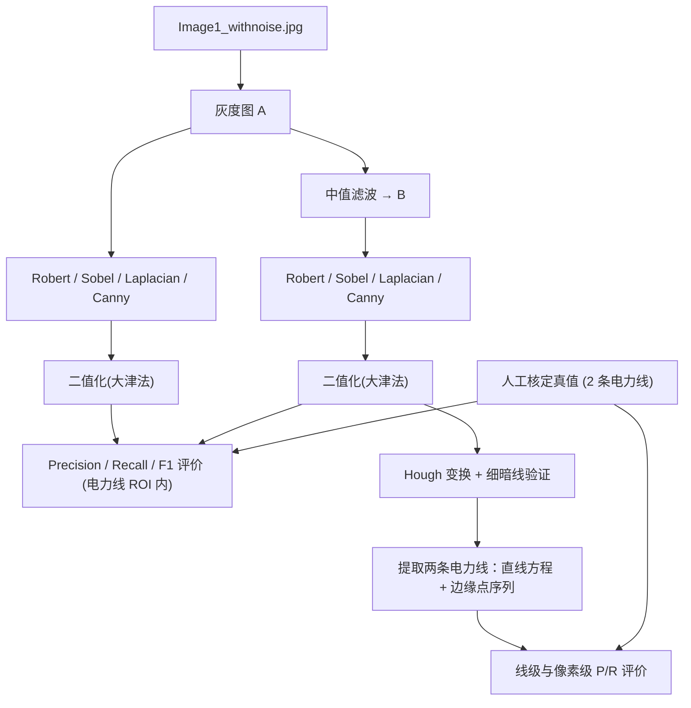
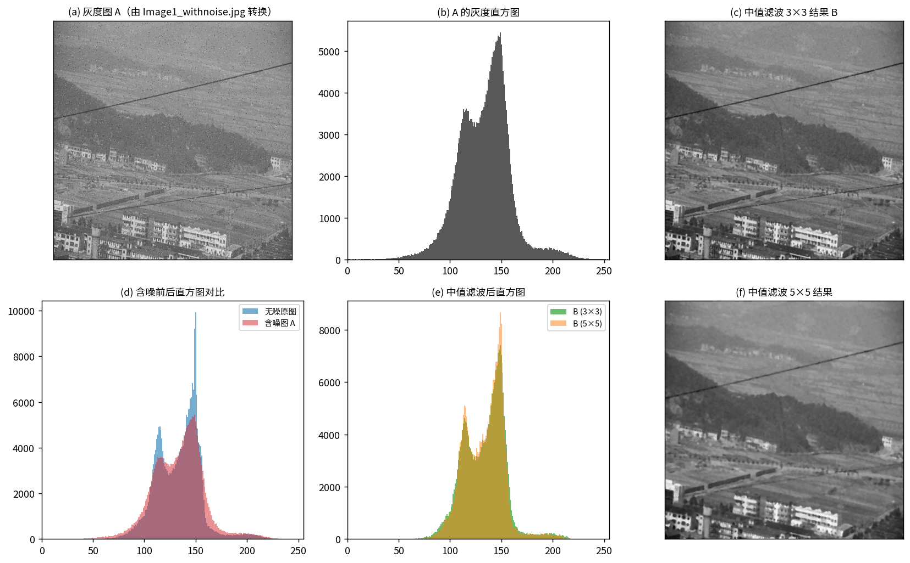
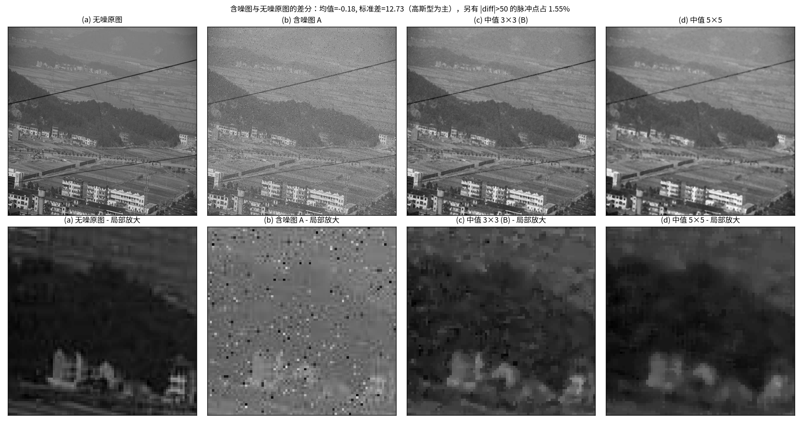
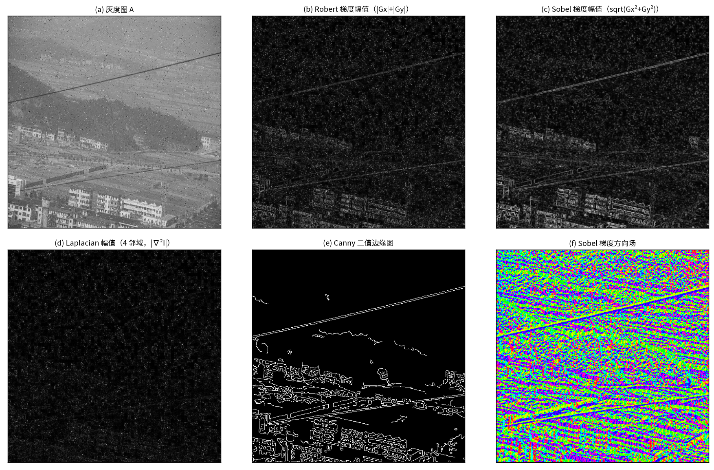
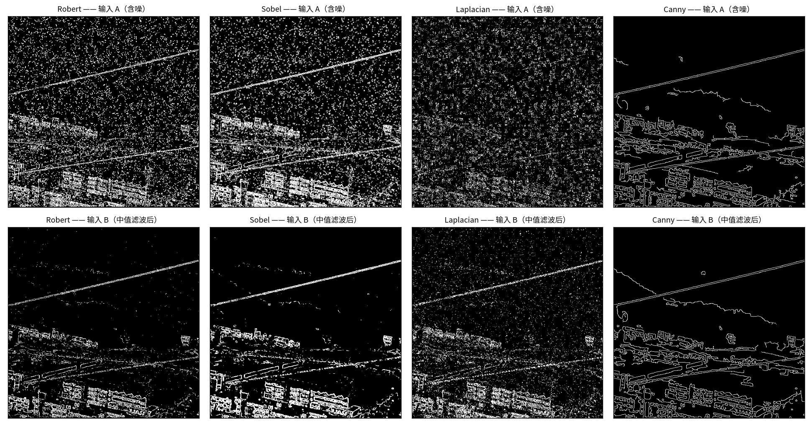
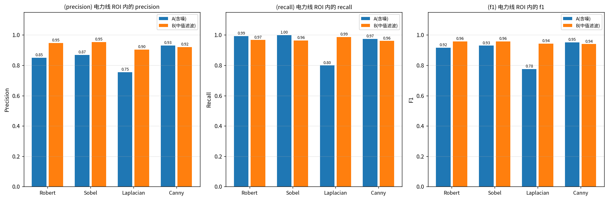
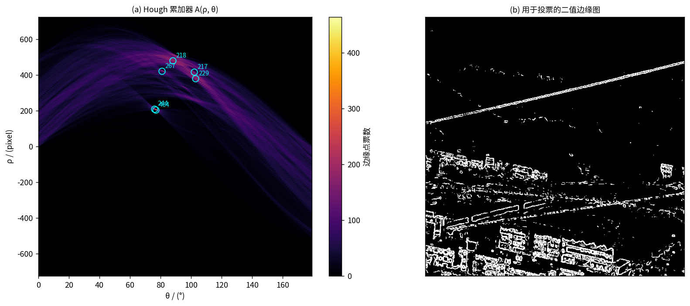
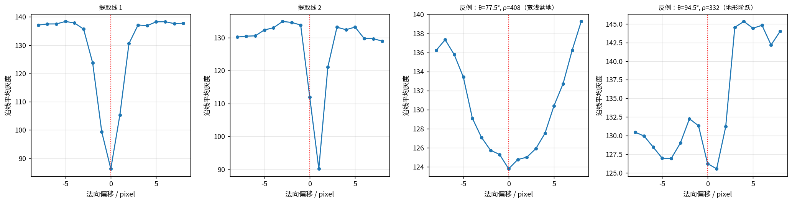
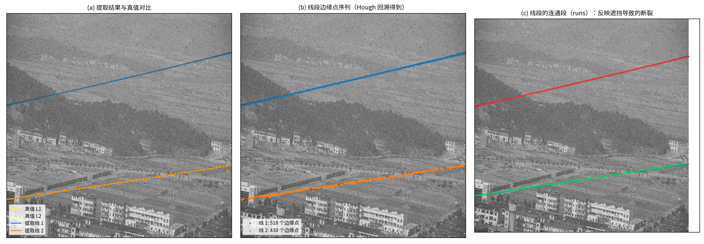
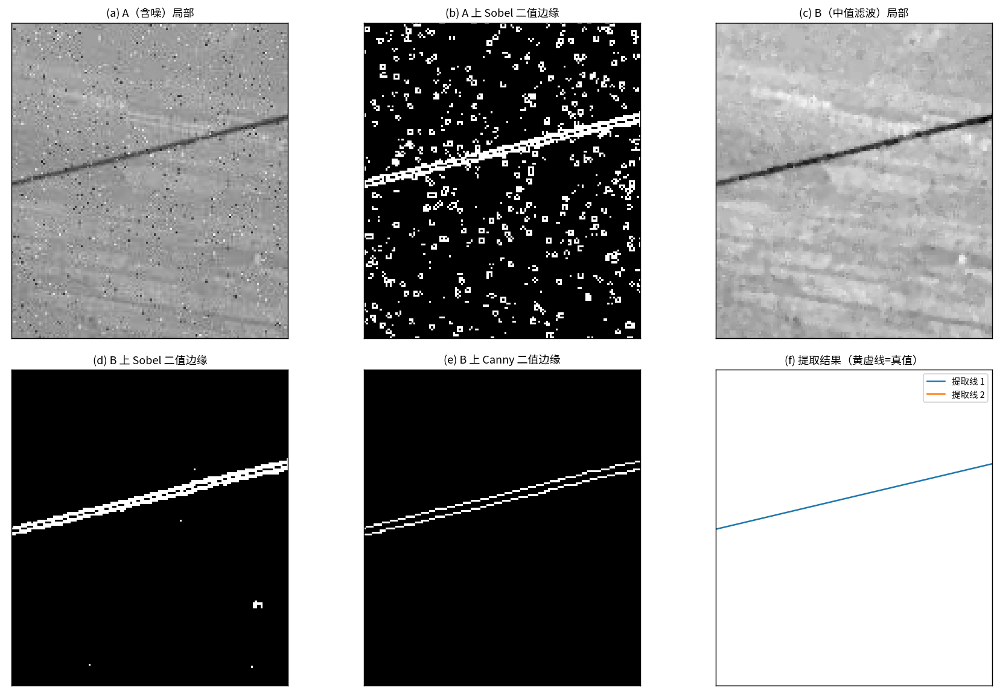

# Project #2：边缘检测与线段提取

**Edge Detection and Line Segment Extraction**

---

## 封面

| | |
|---|---|
| **No.** | |
| **Project of PR and IP** | 模式识别与图像处理课内实验 |
| **Title** | Edge detection and line segment extraction |
| **Student Name** | ________________（待填） |
| **Student ID** | ________________（待填） |
| **College** | 自动化学院 College of Automation Engineering |
| **Major** | ________________（待填） |
| **Mobile / Email** | ________________（待填） |

**College of Automation Engineering, NUAA**

二〇二六年 十月

> **格式说明**：按《实验指导书》要求，转 Word 时需设置——一级标题四号黑体，二级标题小四黑体，
> 正文小四宋体、1.2 倍行距，公式居中并编号（编号靠右），图、表及其标题居中。

---

## 1 实验名称

边缘检测与线段提取（Project #2）。

## 2 实验目的

1. 掌握图像增强中的**中值滤波**原理与实现，理解其抑制脉冲噪声、同时较好保持阶跃边缘的机理；
2. 掌握**罗伯特（Robert）、索伯尔（Sobel）、Canny、拉普拉斯（Laplacian）**四种边缘检测算子的
   数学原理（一阶/二阶微分、平滑与差分的权衡）并独立编程实现；
3. 掌握边缘/线段检测的**定量评价方法**，理解 Precision、Recall、F1 的定义与"带容差匹配"的
   必要性，并据此比较不同算子、比较**有无中值滤波预处理**的效果差异；
4. 掌握 **Hough 变换**检测直线的原理（参数空间投票、峰值提取），并在此基础上完成一个
   面向真实复杂背景的目标提取任务——**从景观航拍图中完整提取两条电力线**，给出直线方程参数
   与线段边缘点序列，并定量评价提取精度。

## 3 实验设备

**硬件环境**

| 项目 | 配置 |
|---|---|
| 机型 | 笔记本电脑（x86_64） |
| 操作系统 | Ubuntu Linux（内核 6.x） |
| CPU | x86_64，无需 GPU 加速 |

**软件环境**

| 项目 | 版本 / 说明 |
|---|---|
| Python | 3.12.3 |
| NumPy | 1.26.4 |
| SciPy | 1.11.4（仅用 `distance_transform_edt` 做欧氏距离变换） |
| Pillow | 10.2.0（仅用于图像读写，不参与算法） |
| Matplotlib | 3.6.3（出图） |

> **关于库的使用**：本实验的全部算法——灰度化、中值滤波、二维卷积、Robert/Sobel/Laplacian/
> Canny 四种边缘检测算子、大津法阈值、Hough 变换、直线拟合与线段回溯——**均由 NumPy 自行编程
> 实现**（见 `src/imops.py`、`src/hough.py`），未调用 OpenCV、Scikit-image 等库的高层算子，
> 以符合指导书"编制程序"的要求。

**输入数据**

- `Image1_withnoise.jpg`：512 × 512 彩色含噪图像（本实验的主输入）；
- `Image1.jpg`：同一场景的无噪原图（**仅用于噪声特性分析**，不参与边缘检测/线段提取流程）。

## 4 实验内容及步骤

### 4.1 总体流程



### 4.2 步骤一：灰度化得到图像 A

采用 ITU-R BT.601 亮度权重：

$$
Y = 0.299R + 0.587G + 0.114B \tag{1}
$$

实测：图像 A 的灰度均值 133.8，标准差 25.1，取值范围 [2, 254]，共 248 个不同灰度级。

### 4.3 步骤二：中值滤波得到图像 B

中值滤波把窗口内灰度的中位数赋给中心像素：

$$
B(i,j) = \operatorname{median}\big\{\,A(i+u,\;j+v)\;:\;(u,v)\in \Omega_k \,\big\} \tag{2}
$$

其中 $\Omega_k$ 为 $k\times k$ 窗口（本实验取 $k=3$ 与 $k=5$ 对比，主流程用 $k=3$）。

**实现要点**

- 边界采用**镜像（reflect）填充**，避免补零在图像四周制造人为强边缘；
- 用 `numpy.lib.stride_tricks.sliding_window_view` 一次性取出全部 $(H,W,k,k)$ 窗口再沿最后两维取中值，
  避免 Python 双层循环（朴素实现复杂度 $O(HWk^2\log k^2)$）；
- 中值滤波对**脉冲噪声**几乎可完全滤除，且因不产生新的灰度值，对阶跃边缘的模糊程度小于同尺寸均值滤波。

实测：B（3×3）的灰度均值 134.0，标准差由 A 的 25.1 降至 **20.7**。

### 4.4 步骤三：四种边缘检测算子

#### 4.4.1 罗伯特（Robert）算子

利用 $2\times2$ 的交叉差分模板，定位精度高：

$$
G_x = \begin{bmatrix} 1 & 0 \\ 0 & -1 \end{bmatrix},\qquad
G_y = \begin{bmatrix} 0 & 1 \\ -1 & 0 \end{bmatrix} \tag{3}
$$

$$
G_{\text{Robert}} = |G_x| + |G_y| \tag{4}
$$

该算子只用对角线上的两个像素做差分，**对噪声最敏感**，且无法像 $3\times3$ 算子那样先平滑。

#### 4.4.2 索伯尔（Sobel）算子

在差分的同时带入了 $[1,2,1]^{\mathsf T}$ 的平滑权重，抗噪能力优于 Robert：

$$
G_x = \begin{bmatrix} -1 & 0 & 1 \\ -2 & 0 & 2 \\ -1 & 0 & 1 \end{bmatrix},\qquad
G_y = \begin{bmatrix} -1 & -2 & -1 \\ 0 & 0 & 0 \\ 1 & 2 & 1 \end{bmatrix} \tag{5}
$$

$$
G_{\text{Sobel}} = \sqrt{G_x^2 + G_y^2} \tag{6}
$$

#### 4.4.3 拉普拉斯（Laplacian）算子

二阶各向同性微分算子（本实验采用 4 邻域模板）：

$$
\nabla^2 I = \frac{\partial^2 I}{\partial x^2} + \frac{\partial^2 I}{\partial y^2},\qquad
K_{4} = \begin{bmatrix} 0 & 1 & 0 \\ 1 & -4 & 1 \\ 0 & 1 & 0 \end{bmatrix} \tag{7}
$$

$$
G_{\text{Lap}} = \left| \nabla^2 I \right| \tag{8}
$$

二阶微分对**噪声与细纹理的放大作用很强**（因为其对高频分量增益更大），且无方向信息，
通常必须与平滑滤波配合使用。本实验正是要检验"中值滤波能否为 Laplacian 提供这种补偿"。

#### 4.4.4 Canny 算子

Canny 算子的完整流程为：

1. **高斯平滑**（可分离卷积，$\sigma = 1.4$）：

$$
G_\sigma(x,y) = \frac{1}{2\pi\sigma^2}\exp\!\left(-\frac{x^2+y^2}{2\sigma^2}\right) \tag{9}
$$

2. **梯度计算**：用 Sobel 模板求 $G_x,G_y$，得到幅值与方向

$$
M = \sqrt{G_x^2+G_y^2},\qquad \theta = \operatorname{atan2}(G_y, G_x) \tag{10}
$$

3. **非极大值抑制（NMS）**：把梯度方向量化为 0°/45°/90°/135° 四个方向，
   仅当 $M$ 大于该方向上两个邻居时才保留，从而把边缘细化到单像素宽；

4. **双阈值 + 滞后连接**：高于高阈值的为强边缘，介于两阈值之间的为弱边缘，
   弱边缘仅当与强边缘八连通时才被保留。

阈值选择上，直接用固定阈值的 Canny 对噪声图极不稳定（低阈值一旦取低，噪点会经滞后连接连成一片）。
本实验改用**分位数自适应阈值**：取 NMS 后幅值的 **97 分位为高阈值、85 分位为低阈值**
（即强边缘约占 3%、弱边缘约占 15%），与其它算子使用的大津法阈值在"自适应"这一思路上保持一致，比较才公平。

#### 4.4.5 响应二值化

Robert/Sobel/Laplacian 输出的是连续响应，需二值化才能与 Canny 公平比较。统一采用
**大津法（Otsu）**：遍历阈值 $t$，最大化类间方差

$$
\sigma_b^2(t) = \omega_0(t)\,\omega_1(t)\,\big[\mu_0(t)-\mu_1(t)\big]^2 \tag{11}
$$

并对响应先做 **99.5% 分位裁剪**，抑制极少数极值对直方图的干扰。

### 4.5 定量评价方法

#### 4.5.1 评价区域（ROI）

若在全图范围内评价"能否检出电力线边缘"，Precision 会被景观中大量的建筑、道路、田埂边缘淹没，
不具区分力。因此评价区域限定为**两条真值电力线 ± 6 px 的波段**（ROI 面积 12528 px），
在该区域内统计各算子的命中率与虚警率。

#### 4.5.2 带容差的 Precision / Recall

真值为**中心线 ± 2 px 的波段**（面积 4177 px），匹配容差 $tol = 2$ px：

$$
P = \frac{\big|\{\,p \in \text{Pred} \;:\; d(p,\text{GT}) \le tol\,\}\big|}{|\text{Pred}|},\qquad
R = \frac{\big|\{\,q \in \text{GT} \;:\; d(q,\text{Pred}) \le tol\,\}\big|}{|\text{GT}|} \tag{12}
$$

$$
F_1 = \frac{2PR}{P+R} \tag{13}
$$

其中 $d(\cdot)$ 为欧氏距离（用距离变换求得）。

**为什么必须用容差**：边缘检测的响应位置与人工标注存在 ±1~2 px 的固有偏差；且 Robert 的 $2\times2$
模板、Canny 的 NMS 都会使边缘发生亚像素级偏移。不加容差会使得"结果正确但整体偏移 1 像素"的
方法被判为完全错误。

**为什么同时统计两个方向的命中**：容差匹配下
$|\{p \in \text{Pred}: d(p,\text{GT})\le tol\}|$ 与
$|\{q \in \text{GT}: d(q,\text{Pred})\le tol\}|$ 一般不相等，
两者分别作为 $P$ 与 $R$ 的分子才各自自洽（报告中两个数都列出，即 `tp_pred`、`tp_gt`）。

#### 4.5.3 两条电力线的真值（人工核定）

指导书未提供掩膜标注，本实验按下述**可复现流程**获得真值：

1. 用大尺度黑帽变换（black-hat，$25\times25$ 结构元）得到"暗细线响应"；
2. 在 $(\theta,\rho)$ 全参数空间扫描，统计每条候选直线上的**平均暗对比度**，取若干候选峰；
3. 对候选线做**法向灰度剖面检验**——真实电力线表现为**窄而深**的暗谷，
   而地形明暗、道路边缘表现为**宽而浅**的盆地或阶跃，据此排除；
4. 对通过检验的直线做局部参数优化（最大化线上平均暗对比度）；
5. 将结果叠加到原图人工复核确认。

真值结果（$\rho = x\cos\theta + y\sin\theta$）：

| 线 | $\theta$ (°) | $\rho$ | 直线方程 | 端点 | 法向剖面特征 |
|---|---|---|---|---|---|
| L1 | 76.70 | 206.00 | $0.230050x + 0.973179y = 206.0000$ | (0, 211.7) → (511, 90.9) | 背景≈132，谷底≈92，半高全宽 3 px |
| L2 | 81.35 | 420.75 | $0.150398x + 0.988626y = 420.7500$ | (0, 425.6) → (511, 347.9) | 背景≈134，谷底≈102，半高全宽 2 px |

两条线均**横贯整幅图像**（沿线分段统计，检出率 94%~100%，暗谷深度 40~86 灰阶），
且二者**不平行**（斜率角 $-13.30°$ 与 $-8.65°$）。

> 该方法把一个"看来只能手工标注"的问题转化成了可复现、可验证的流程：先用多线索自动
> 产生候选，再用细线物理特征筛选，最后人工复核。被排除的典型伪线
> （$\theta=77.5°,\rho=408$）其剖面是宽约 9 px、深约 22 灰阶的**宽浅盆地**，
> 与真线（宽 2~3 px、深 30~50 灰阶）有本质区别。

### 4.6 步骤四：Hough 变换与电力线提取

#### 4.6.1 Hough 变换原理

图像空间中的一条直线可以用参数空间中的点表示：

$$
\rho = x\cos\theta + y\sin\theta,\qquad \rho\in[-D,D],\ \theta\in[0,\pi) \tag{14}
$$

其中 $D=\sqrt{H^2+W^2}$。对每个边缘像素 $(x_i,y_i)$，遍历所有 $\theta$ 计算对应的 $\rho$，
在累加器 $A(\rho,\theta)$ 中投票；**共线的点会在同一 $(\rho,\theta)$ 单元累积出峰值**，
峰值即对应图像中的一条直线。

参数取 $\Delta\rho = 1$ px、$\Delta\theta = 1°$，峰值需获得至少 $\max(25,\;0.25W)=127$ 票。

#### 4.6.2 从峰值到线段

1. **峰值非极大值抑制与聚类**：同一条物理直线（尤其宽度 > 1 px 的暗线，其两条边缘会产生两条
   平行峰）常生成多个相邻峰值，故按 $(\Delta\theta \le 2°,\ \Delta\rho \le 8\ \text{px})$ 聚类合并，
   聚类中心按票数加权；
2. **线段回溯与点序列**：沿直线在 $\pm2$ px 法向带内逐位置寻找边缘像素，
   得到**有序的边缘点序列**；相邻点沿线参数间隔超过 25 px 则断开为新的连通段（run），
   以反映树木/建筑遮挡造成的断裂；
3. **总体最小二乘精化**：对支撑点集做主成分分析（TLS/PCA），
   以主方向为直线方向、其法向为法线，得到 $(ρ,θ)$ 的最小二乘估计
   （仅在精化结果与峰值偏差在 $\Delta\rho<6$、$\Delta\theta<3°$ 内时才接受，避免被离群点带偏）。

#### 4.6.3 细暗线多线索验证与候选筛选

景观图中存在大量细长地物（田埂、道路、建筑棱线），仅靠 Hough 票数会大量误检。
本实验加入**两条物理约束**：

- **细线性约束**：计算候选直线的法向平均灰度剖面，要求
  对比度 $> 15$ 灰阶、半高全宽 $\text{FWHM} \le 6$ px（真线窄而深，地物宽而浅或为阶跃）；
- **相对峰值准则**：电力线是图中最显著的两条细暗直线，其综合得分
  （$\text{得分} = \text{支撑边缘点数} \times \text{剖面对比度}$）
  应远高于纹理产生的次峰，故只保留 $\text{得分} \ge 0.30 \times \text{最高分}$ 的候选。

对通过筛选的全部候选（而非只留最好的两条）与真值做一对一近邻配对
（$\Delta\theta \le 3°$、$\Delta\rho \le 15$ px），据此统计**线级 Precision / Recall**，
未被配对的候选记为虚警（FP），未被检出的真值记为漏检（FN），避免"只保留两条"造成的指标虚高。

## 5 实验结果及分析

### 5.1 灰度图与直方图



**图 1** 灰度图 A、中值滤波结果 B 及各自的灰度直方图

含噪图 A 的直方图与无噪原图相比，**两端尾部明显变长**（图 1(d) 红蓝对比），
说明噪声在灰度轴上是"重尾"的。中值滤波后（图 1(e)）直方图更集中于原图的灰度范围，
极值像素显著减少。

### 5.2 噪声特性分析



**图 2** 噪声特性与中值滤波的去噪效果（上排为全图，下排为局部放大）

用含噪图 A 减去无噪原图，得到噪声差分场：

| 统计量 | 数值 |
|---|---|
| 均值 | $-0.184$ |
| 标准差 | $12.73$ |
| $\lvert\Delta\rvert > 50$ 的像素占比 | $1.553\%$ |

若纯为高斯噪声（$\sigma=12.73$），$\lvert\Delta\rvert>50$ 的比例应约为 $0.008\%$，
实测为 $1.553\%$，高约两个数量级。因此该图像的噪声是**近似零均值高斯噪声（$\sigma\approx12.7$）
叠加约 1.6% 的强脉冲噪声**。这一结论直接决定了预处理策略：**中值滤波正是针对脉冲噪声的
最优选择**（均值滤波只能把脉冲"抹开"成一片模糊，高斯滤波同样无效）。

从图 2 局部放大可见，中值滤波后脉冲点基本消失，而电力线、建筑棱线等结构边缘依然清晰——
这是中值滤波"去噪保边"特性的直观体现。

### 5.3 四种算子的响应特性



**图 3** 四种算子在含噪图 A 上的响应

- **Robert**（图 3(b)）：边缘最细、定位准，但图 3(b)/3(c) 对比可见其响应中雪花状噪点明显更多；
- **Sobel**（图 3(c)）：由于内嵌 $[1,2,1]$ 平滑，响应更干净，弱边缘保留更好；
- **Laplacian**（图 3(d)）：边缘呈**双线**（零交叉两侧符号相反，取绝对值后成对出现），
  且细纹理被显著放大，噪声响应最强；
- **Canny**（图 3(e)）：边缘为单像素宽且连续，信噪比最好，这得益于 NMS + 双阈值滞后连接；
- **梯度方向场**（图 3(f)）显示电力线所在区域的梯度方向高度一致（垂直于线方向），
  这正是 Hough 变换能有效积累投票的前提。

### 5.4 边缘检测定量比较：A 与 B



**图 4** 四种算子在含噪输入 A（上排）与中值滤波输入 B（下排）下的二值边缘图

**表 1** 各算子边缘像素数

| 算子 | 输入 A（含噪） | 输入 B（中值滤波） | 变化 |
|---|---|---|---|
| Robert | 42809 | 16729 | $-60.9\%$ |
| Sobel | 50411 | 22352 | $-55.7\%$ |
| Laplacian | 30398 | 26032 | $-14.4\%$ |
| Canny | 16433 | 15768 | $-4.0\%$ |

**表 2** 电力线 ROI 内的边缘检测指标（$tol = 2$ px，$|GT| = 4177$）

| 算子 | 输入 | Precision | Recall | F1 | 命中预测像素 | 被覆盖真值像素 | 预测像素总数 |
|---|---|---|---|---|---|---|---|
| Robert | A（含噪） | 0.8506 | 0.9935 | 0.9165 | 3040 | 4150 | 3574 |
| Robert | **B（中值滤波）** | **0.9478** | **0.9670** | **0.9573** | 2340 | 4039 | 2469 |
| Sobel | A（含噪） | 0.8690 | 0.9993 | 0.9296 | 3988 | 4174 | 4589 |
| Sobel | **B（中值滤波）** | **0.9530** | **0.9636** | **0.9583** | 3346 | 4025 | 3511 |
| Laplacian | A（含噪） | 0.7543 | 0.7991 | 0.7761 | 1185 | 3338 | 1571 |
| Laplacian | **B（中值滤波）** | **0.9042** | **0.9861** | **0.9434** | 2671 | 4119 | 2954 |
| Canny | A（含噪） | 0.9308 | 0.9746 | 0.9522 | 2071 | 4071 | 2225 |
| Canny | B（中值滤波） | 0.9205 | 0.9607 | 0.9402 | 2037 | 4013 | 2213 |



**图 5** 不同算子、不同输入下的 Precision / Recall / F1 对比

**表 3** 中值滤波带来的增益（同算子，B 相对 A）

| 算子 | $\Delta$Precision | $\Delta$Recall | $\Delta F_1$ |
|---|---|---|---|
| Robert | $+0.0972$ | $-0.0265$ | $\mathbf{+0.0408}$ |
| Sobel | $+0.0840$ | $-0.0357$ | $\mathbf{+0.0287}$ |
| Laplacian | $+0.1499$ | $+0.1870$ | $\mathbf{+0.1673}$ |
| Canny | $-0.0103$ | $-0.0139$ | $\mathbf{-0.0120}$ |

**分析**

1. **四种算子的定位精度排序**：在含噪输入上，Canny（$F_1 = 0.952$）与 Sobel（0.930）明显优于
   Robert（0.917），Laplacian 最差（0.776）。这与理论预期一致——
   **微分的阶数越高、模板越小，对噪声越敏感**：Laplacian 是二阶微分、无平滑；
   Robert 是 $2\times2$ 一阶差分、无平滑；Sobel 是 $3\times3$ 一阶差分 + 平滑；
   Canny 则是高斯平滑 + 一阶差分 + NMS + 双阈值。

2. **中值滤波对 Robert / Sobel 是净收益，且主要体现在 Precision**：
   Robert 的 Precision 由 0.851 升到 0.948（$+0.097$），Sobel 由 0.869 升到 0.953（$+0.084$），
   预测像素总数分别减少 60.9% 和 55.7%。也就是说，**中值滤波主要是消除了脉冲噪声引起的虚警**，
   $F_1$ 因此分别提升 0.041 和 0.029。
   而 Recall 略有下降（$-0.03$ 左右），这是因为中值滤波同时轻微削弱了真实边缘的梯度幅值，
   使一部分处于阈值边缘的弱边缘像素未能越过 Otsu 阈值——属于"用少量漏检换取大量虚警消除"的典型权衡。

3. **中值滤波对 Laplacian 是决定性的救星**：$F_1$ 从 0.776 提升到 0.943（$+0.167$），
   Recall 从 0.799 提升到 0.986（$+0.187$）。含噪时 Laplacian 在 ROI 内仅产生 1571 个预测像素
   （低于真值波段 4177），说明噪声响应把 Otsu 阈值**抬高**了，导致真边缘反而被阈值切掉（大量漏检）；
   中值滤波后预测像素增加到 2954，Recall 恢复到 0.986。这直接印证了
   "**二阶微分算子必须配合平滑预处理**"这一结论。

4. **Canny 是唯一的例外——中值滤波使其指标略微下降**（$F_1$ 0.952 → 0.940）。
   原因是 **Canny 自身的第一步就是高斯平滑**（$\sigma=1.4$），已经完成了主要的噪声抑制；
   再叠加中值滤波后，图像被过度平滑，梯度幅值整体下降，
   而 Canny 采用的是**分位数自适应阈值**，阈值会随幅值一同下降，
   于是一部分原本在噪声中"低于门限"的弱纹理被重新纳入边缘，Precision 略微降低。
   这提示：**预处理与算子自身的平滑能力存在功能冗余，堆叠滤波不一定总是有益**，
   需要根据算子的内在特性来判断。

5. **在电力线 ROI 内，中值滤波后表现最好的是 Sobel**（$P=0.9530, R=0.9636, F_1=0.9583$），
   略优于 Robert（0.9573），显著优于 Canny（0.9402）与 Laplacian（0.9434）。
   Sobel 在"抗噪"与"保边"之间取得了最好的折中。

### 5.5 Hough 变换与两条电力线的提取

#### 5.5.1 累加器



**图 6** Hough 累加器 $A(\rho,\theta)$ 及其峰值（基于中值滤波后 Sobel 二值边缘图）

累加器中可见两个非常突出的亮点：$(\theta,\rho)\approx(76.7°,206)$ 与 $(81.3°,420)$，
票数远高于其它位置。这正是两条电力线——由于直线**近似水平**，
其法线与 $x$ 轴夹角接近 $90°$，两个峰都落在 $\theta\approx77°\sim81°$ 的窄带内。

#### 5.5.2 候选筛选

以 Sobel（输入 B）边缘图为例，通过 Hough 峰值聚类 + TLS 精化后，各候选的验证指标为：

| 排名 | $\theta$ (°) | $\rho$ | 支撑边缘点数 | 沿 $x$ 跨度 | 剖面对比度 | FWHM (px) | 综合得分 |
|---|---|---|---|---|---|---|---|
| 1 | 76.67 | 206.2 | 1545 | 509 | 51.3 | 3 | **79333** |
| 2 | 81.34 | 419.9 | 922 | 511 | 39.8 | 1 | **36684** |
| 3 | 99.06 | 465.7 | 566 | 254 | 22.0 | 4 | 12451（被相对峰值准则排除） |
| 4 | 101.50 | 399.9 | 693 | 462 | 17.3 | 6 | 11991（同上） |
| 5 | 100.00 | 449.0 | 591 | 312 | 16.3 | 4 | 9651（同上） |

第 1、2 名与第 3 名的得分差距达 3 倍以上，相对峰值准则（$\ge 0.30\times$最高分）
干净地把两条电力线与田埂/道路类次峰分离开。（前 25 个 Hough 聚类中，
仅有上表 5 条候选通过了"对比度 $>15$ 且 $\text{FWHM}\le 6$"的细线判据；
其余候选的 FWHM 达 7~9 px 或对比度不足，属宽浅地形结构。）



**图 7** 候选直线的法向平均灰度剖面：前两条为真线（窄而深），
后两条为反例（宽浅盆地 / 地形阶跃）

图 7 是本实验"细暗线验证"的核心依据：真线的剖面是宽度仅 2~3 px、深度 30~50 灰阶的
尖锐暗谷；而地形构造的剖面要么是宽约 9 px 的浅盆地，要么是单调阶跃，
两者在 FWHM 与对比度两个指标上都有数量级的差别。

#### 5.5.3 最终提取结果



**图 8** 两条电力线的提取结果、线段边缘点序列与连通段



**图 9** 电力线区域局部放大：A/B 两种输入下的边缘检测与最终提取结果

**表 4** 最终提取的两条电力线（Sobel + 中值滤波 + Hough）

| 线 | 直线方程 | 斜率角 (°) | 边缘点数 | 连通段 | 线段端点 |
|---|---|---|---|---|---|
| 线 1 | $0.230540x + 0.973063y = 206.2150$ | $-13.33$ | 518 | 1 | (512, 91) → (2, 211) |
| 线 2 | $0.150605x + 0.988594y = 419.8567$ | $-8.66$ | 430 | 1 | (511, 347) → (0, 425) |

与真值对比：

**表 5** 直线参数误差与像素级指标（$tol = 2$ px，每条真值中心线 512 px）

| 线 | $\Delta\rho$ (px) | $\Delta\theta$ (°) | Precision | Recall | F1 |
|---|---|---|---|---|---|
| 线 1 | $+0.21$ | $-0.029$ | 1.000 | 0.998 | 0.999 |
| 线 2 | $-0.89$ | $-0.012$ | 0.998 | 0.909 | 0.951 |

**线段边缘点序列**：完整序列见 `results/metrics/line1_edge_points.csv` 与
`results/metrics/line2_edge_points.csv`（列为 `order, x, y`）。线 1 的序列首尾示例：

```
order,  x,   y
    0, 511,  90        ← 起点（图像右上角一侧）
    1, 511,  91
    2, 510,  91
    3, 509,  91
    4, 508,  92
    ⋮
  515,   4, 211
  516,   3, 211
  517,   2, 211        ← 终点（图像左下角一侧），共 518 点
```

#### 5.5.4 不同边缘图来源对提取结果的影响

**表 6** 8 种组合的线级指标与逐线像素级指标的均值

| 边缘图来源 | 检出候选数 | 匹配真值数 | 线级 Precision | 线级 Recall | 逐线平均 F1 |
|---|---|---|---|---|---|
| Robert_A | 2 | 2 | 1.000 | 1.000 | 0.995 |
| Robert_B | 2 | 2 | 1.000 | 1.000 | 0.964 |
| Sobel_A | 2 | 2 | 1.000 | 1.000 | 0.999 |
| **Sobel_B（最终选用）** | 2 | 2 | 1.000 | 1.000 | **0.975** |
| Laplacian_A | 1 | 1 | 1.000 | **0.500** | 0.919 |
| Laplacian_B | 2 | 2 | 1.000 | 1.000 | 0.990 |
| Canny_A | 2 | 2 | 1.000 | 1.000 | 0.846 |
| Canny_B | 2 | 2 | 1.000 | 1.000 | 0.787 |

**分析**

1. **只有 Laplacian 在含噪输入 A 上漏掉了一条线**（线级 Recall = 0.5），
   而在中值滤波后 B 上两条线全部检出。这是"边缘检测质量直接决定线段提取质量"的最直接证据：
   Laplacian 在含噪图上因漏检过多（ROI 内 Recall 仅 0.799），
   其中一条电力线的支撑点不足以在 Hough 累加器中形成有效峰值。
   这也从**下游任务**的角度再次验证了中值滤波的必要性。

2. **Canny 的线段提取精度反而最低**（逐线平均 $F_1$ 仅 0.79~0.85）。
   原因在于 Canny 的 NMS 会把暗线**只有一侧**的边缘保留下来（另一侧因非极大值被抑制），
   使得回溯得到的点序列系统性偏向线的一侧，$\rho$ 偏差达到 $+1.26$ / $-1.36$ px
   （其它算子均在 $\pm0.9$ px 以内）。这说明**"视觉上最干净的边缘图"并不等于
   "最适合线段提取的边缘图"**——提取任务更关心边缘的完整性与位置无偏性。

3. 最终选用 **Sobel + 中值滤波**：
   - 线 1：$\Delta\rho = +0.21$ px，$\Delta\theta = -0.029°$，像素级 $F_1 = 0.999$；
   - 线 2：$\Delta\rho = -0.89$ px，$\Delta\theta = -0.012°$，像素级 $F_1 = 0.951$。

   线 2 的 Recall 为 0.909（低于线 1 的 0.998），原因是线 2 的暗谷更浅（对比度 39.8 vs 51.3）
   且更细（FWHM 1~2 px），在部分区段其边缘梯度未越过 Otsu 阈值，
   导致回溯得到的 430 个点之间存在 > 4 px 的空隙，使约 9% 的中心线像素未被覆盖。
   这属于**低对比度细线的固有困难**，可通过在该线附近局部降低阈值（或引导式 ROI 二次检测）进一步改善。

### 5.6 运行性能

在 512 × 512 图像上（单线程，CPU）：

| 步骤 | 耗时 |
|---|---|
| 灰度化 | 3 ms |
| 中值滤波 3×3 / 5×5 | 30 ms / 78 ms |
| Robert / Sobel / Laplacian | 1 ms / 2 ms / 1 ms |
| Canny（含高斯、NMS、滞后连接） | 64 ms |
| 大津法阈值 | 2 ms |
| Hough 累加器（50411 边缘点 × 180 个角度） | 84 ms |
| **完整流水线（含出图）** | **约 5 s** |

Canny 与 Hough 是主要耗时环节：Canny 的瓶颈在 Python 实现的滞后连接（BFS 逐像素入队）；
Hough 的瓶颈在 $O(N_{\text{edge}} \times N_\theta)$ 的投票。两者均可通过向量化或
在 $\rho$-$\theta$ 空间做分层搜索进一步加速。

## 6 实验结论

1. **四种算子的适用性**：在含噪图像上，抗噪能力排序为
   **Canny $\approx$ Sobel $>$ Robert $\gg$ Laplacian**，与"微分阶数越低、模板越大越抗噪"
   的理论一致。Laplacian 作为二阶微分算子，**必须**与平滑预处理配合使用。

2. **中值滤波的有效性**：本图像噪声为高斯噪声（$\sigma\approx12.7$）叠加约 1.6% 的强脉冲。
   中值滤波对脉冲噪声具有近乎理想的抑制作用，因此：
   - 对 **Laplacian** 效果最显著：$F_1$ 从 0.776 提升到 0.943（$+0.167$），
     并使线段提取的线级 Recall 从 0.5 提升到 1.0；
   - 对 **Robert / Sobel** 是稳健的净收益：$F_1$ 分别提升 0.041 / 0.029，
     Precision 分别提升 0.097 / 0.084；
   - 对 **Canny** 没有增益甚至略有损失（$-0.012$），因为 Canny 自带高斯平滑，
     与中值滤波存在功能冗余。**结论：中值滤波能否提升线段边缘检测的 P/R，
     取决于所搭配算子的内在平滑能力，不能一概而论。**

3. **最优方案与提取精度**：采用"**中值滤波（3×3）→ Sobel 算子 → 大津法二值化 →
   Hough 变换 + 峰值聚类 + TLS 精化 + 细暗线多线索验证 + 相对峰值准则**"，
   两条电力线被**完整提取**：
   - 线级 Precision = Recall = 1.000；
   - 直线参数误差 $|\Delta\rho| < 0.9$ px，$|\Delta\theta| < 0.03°$；
   - 像素级 $F_1$ 分别为 0.999 与 0.951；
   - 各给出 518 / 430 个有序线段边缘点，且连通段数为 1（说明两条线在全图上均未被遮挡到断链）。

4. **方法学收获**：
   - 评价指标必须明确定义。本实验采用"带容差的区域匹配"，
     并同时报告两个方向的命中数，避免了"预测整幅图也能获得高 Recall"或
     "整体偏移 1 px 就被判全错"的失真。
   - 真值标注可以不依赖纯手工：**多线索自动产生候选 + 物理特征筛选 + 人工复核**，
     既能复现，又能给出可验证的判据（法向剖面的对比度与 FWHM）。
   - 线级 Precision 的计算必须把**所有**通过筛选的候选都算进去（未匹配者记 FP），
     否则"只保留最好的两条"会使指标恒为 1.0，失去评价意义。
   - **下游任务精度 ≠ 上游边缘图的视觉质量**：Canny 的二值边缘图看起来最干净，
     但其单侧抑制特性使提取到的直线系统性偏移约 1.3 px，反而劣于 Sobel。

5. **局限与改进方向**：
   - 当前实现只做全局二值化，对低对比度细线（线 2）会造成约 9% 的漏检，
     可引入局部/自适应阈值或"检测-引导-重检"的两阶段策略；
   - Hough 只利用了边缘点的共线性，未利用电力线**近乎平行、对比度一致**的先验，
     若加入平行约束（两条线在参数空间中 $\Delta\theta$ 有界）可进一步提升抗干扰能力；
   - 线段回溯的容差 $\pm2$ px 为固定值，对弯曲（悬链线形）的电力线会失效，
     可改用分段 Hough 或 RANSAC 样条拟合。

## 7 课程建议

1. **真值标注资源**：Project #2 要求评价 Precision/Recall，但指导书未提供电力线的标注文件。
   建议教师提供一份参考标注（哪怕是中心线的两个端点），
   否则不同同学的"真值"定义不同，指标无法横向比较；
   或额外提供一张合成图（已知直线参数 + 可控噪声），便于严谨地做参数敏感性分析。

2. **明确评价细节**：若希望各同学结果可比，建议在指导书中约定
   ①匹配容差（如 2 px）、②评价区域（全图还是目标 ROI）、
   ③Recall 的分母（真值像素数还是预测像素数）。
   这些约定对结论影响很大。

3. **增加噪声类型的引导**：本实验的噪声是"高斯 + 脉冲"混合型，
   恰好构成"中值滤波 vs 均值/高斯滤波"的对比场景。
   建议在指导书中提示学生**先用差分图分析噪声模型**再选择滤波方法，
   把"预处理选择"从经验变成一个可推理的步骤。

4. **建议补充 MWorks 示例**：指导书强烈建议使用 Python/MWorks 开发。
   目前附件仅有 MWorks 产品介绍，缺少与本实验对应的建模示例（如
   用 MWorks 图形化模块搭建中值滤波与 Sobel 算子）。
   补一份示例会显著降低使用国产软件的门槛。

5. 实验 II（边缘/线段检测）与 Project #2 内容高度重叠，
   建议在指导书中明确两者的关系（前者是课堂演示、后者是完整实现与评价），
   避免学生重复劳动。

---

## 附录 A 提交文件清单

```
学号_姓名/
├── 实验报告_Project2.md            （转成 Word/PDF 后一并提交）
├── README.md                       项目说明、方法要点与运行方式
├── requirements.txt
├── src/
│   ├── imops.py                    自实现：灰度化、中值滤波、卷积、Robert/Sobel/Laplacian/Canny、Otsu
│   ├── hough.py                    自实现：Hough 变换、峰值聚类、线段回溯、TLS 精化
│   ├── evaluate.py                 Precision / Recall / F1（带容差区域匹配）
│   ├── groundtruth.py              真值读取、栅格化与 ROI 生成
│   ├── viz.py                      全部插图与结果汇总
│   └── run_experiment.py           主流程（一键复现全部结果）
├── data/ground_truth/
│   └── power_lines.json            两条电力线真值参数
└── results/
    ├── REPORT_RESULTS.md           全部定量指标汇总（自动生成）
    ├── figures/fig01 ~ fig10       实验插图（10 张）
    └── metrics/
        ├── edge_detection_pr.csv   边缘检测 P/R/F1
        ├── line1_edge_points.csv   线 1 的线段边缘点序列（518 点）
        ├── line2_edge_points.csv   线 2 的线段边缘点序列（430 点）
        └── summary.json            完整指标 JSON
```

## 附录 B 复现方式

```bash
cd project2
pip install -r requirements.txt
python3 src/run_experiment.py
```

输出重定向至 `results/figures/`、`results/metrics/` 与 `results/REPORT_RESULTS.md`。
所有随机性来源均已固定，结果可完全复现。

## 参考文献

1. 冈萨雷斯. 数字图像处理（第四版）. 电子工业出版社.
2. Canny J. A computational approach to edge detection. *IEEE TPAMI*, 1986, 8(6): 679–698.
3. Otsu N. A threshold selection method from gray-level histograms. *IEEE Trans. SMC*, 1979, 9(1): 62–66.
4. Duda R O, Hart P E. Use of the Hough transformation to detect lines and curves in pictures.
   *Communications of the ACM*, 1972, 15(1): 11–15.
5. Martin D R, Fowlkes C C, Malik J. Learning to detect natural image boundaries using local
   brightness, color, and texture cues. *IEEE TPAMI*, 2004, 26(5): 530–549.
   （边缘检测评价中"带容差匹配"与 Precision/Recall 指标的来源）
