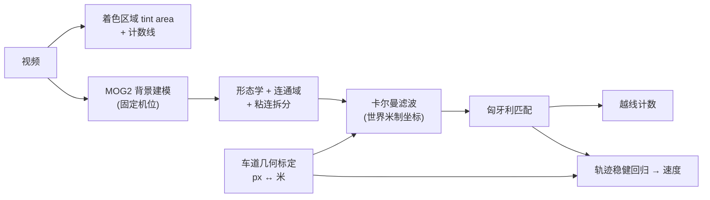

# Task2 — 车辆计数与测速（Vehicle Counting & Speed Measurement）

选做实验 Task2 的实现与结果：对 `../Task2/video1.mp4`（上海内环高架·浦建路下匝道方向的监控视频）
统计**着色区域（tint area）**内通过的车辆数，并测量各车速度。

## 运行

```bash
cd task2_traffic
python3 src/run_task2.py              # 全流程（含标注视频）
python3 src/run_task2.py --no-video   # 跳过视频，更快
python3 src/run_task2.py --hfov 30    # 覆盖标定参数做敏感性分析
```

依赖：`opencv-python`、`numpy`、`scipy`、`matplotlib`。

## 流程



**关键设计**

1. **在世界米制坐标里做跟踪**：路面上的匀速运动映射到 (X, Z) 后仍是匀速直线，
   卡尔曼的匀速模型因此精确成立；若在像素域跟踪，车辆越远移动越慢，模型会系统性失配。
2. **速度用稳健线性回归**（最小二乘 + 两轮 2.5σ 离群剔除）对整条轨迹拟合，
   而不是直接取卡尔曼的速度状态（后者受初始化与噪声影响大）。
3. **剔除贴边帧**：车辆从画面底部进入时被图像边界裁切，检测框会被"钉"在边界上，
   此时算出的 Z 不随时间变化，会把速度严重低估 —— 这类观测被标记为无效并排除出测速。
4. **粘连拆分**：连通域宽度超过 2.6 倍车道宽时，沿列方向前景投影的低谷处切开。

## "着色区域"的定义

指导书只写了 "in the tint area"，未提供标注区域。本实现把**路面近场的一个梯形区域**
定义为 tint area，并在输出视频中以半透明绿色叠加显示：

- 上边界 = 图像第 620 行，下边界 = 第 1078 行
- 左右边界 = 由实测的车道边界线 / 道路右边缘线给出（覆盖 3 条车道）
- 计数线 = 区域内的第 900 行，车辆**由近及远**越过该线计 1 辆

## 相机标定

对固定机位的平面路面，图像与路面之间是一个 8 自由度单应。**仅知道车道宽度，纵向比例在
数学上不可确定**（可以任意拉伸纵向而不改变任何车道线的成像位置），因此本实现采用：

| 信息 | 来源 |
|---|---|
| 横向尺度 | 车道宽度 **3.75 m**（城市快速路标准）；相邻两条车道边界线在每行的像素间距**实测拟合** |
| 消失点 | 两条车道边界线的交点 → (1219.7, −240.7) |
| 相机高度 | **反解得到 10.52 m**（在 4 个不同深度的行上完全一致 ⇒ 验证了两条线确为相邻平行边界，且高度值合理） |
| 纵向尺度 | 唯一自由参数 ⇒ 用**已知物体尺寸自标定**：令检测到的车辆重建长度中位数等于轿车典型车长 4.5 m，反解得 f ≈ 3348 px，即 **HFOV ≈ 32°** |

反解结果：`f = 3348 px`、`h = 10.52 m`、俯仰 `13.1°`、偏航 `4.4°`；
tint area 内可见路面纵向范围约 **25.7 ~ 40.7 m**。
这些值互相自洽（相机高、俯仰角、可见距离、车辆尺寸均落在快速路监控相机的合理范围）。

### 敏感性（重要）

速度与 1/f 近似成正比，而 f 由 HFOV 先验确定，故速度绝对值带有标定不确定度：

| 假设 HFOV | 29° | 32°(默认) | 36° |
|---|---|---|---|
| 平均车速 (km/h) | 46.2 | 44.3 | 39.5 |
| 越线计数 | 11 | 11 | 12 |

**HFOV 在 28°–36° 区间内，平均速度变化约 ±13%，计数稳定在 11–12 辆。**
计数结果不依赖标定；速度的相对大小（哪辆车快、哪辆车慢）也不依赖标定。

## 结果

- 视频：1920×1080 @ 25 fps。**元数据标称 378 帧（15.12 s），但实际仅 328 帧可解码（13.12 s）**，
  文件尾部有损坏/截断；全部统计基于可解码的 328 帧。
- 处理速度：**34 fps**（约 0.4× 实时，单线程 CPU）。

| 指标 | 数值 |
|---|---|
| 确认航迹数（区域内出现的不同车辆） | **18** |
| **越线车辆数（区域计数）** | **11** |
| 其中短航迹（<10 帧）| 2 |
| 给出速度估计的车辆数 | 9 |
| **车速** | 均值 **44.3**、中位 **44.6**、标准差 14.1、范围 22.7–65.1 km/h |

逐车速度见 `results/metrics/tracks.csv`（含轨迹起止位置、时间、拟合 R²、有效样本数）。

> 说明：计数为 11 而非 18，是因为视频开始时刻区域内已有若干车辆（它们没有"穿越"计数线）；
> 18 是区域内出现过的不同车辆总数，11 是完整穿过计数线的车辆数。两个数都列出以便对照。

## 输出文件

```
results/
├── video/annotated.mp4                 标注视频（着色区域、计数线、跟踪框+ID+实时速度、HUD）
├── figures/
│   ├── fig_t2_calibration.png          着色区域/车道线/计数线 + 路面米制网格反投影
│   ├── fig_t2_bev_tracks.png           鸟瞰图上的轨迹（颜色=速度）
│   ├── fig_t2_speed.png                速度分布 + 逐车速度
│   ├── fig_t2_timeline.png             累计计数曲线 + 各航迹在区域内的时段
│   └── fig_t2_track_gallery.png        逐车核对长廊（每条航迹的时序抽样）
└── metrics/
    ├── tracks.csv                      逐车明细
    └── summary.json                    标定参数 + 汇总指标 + 越线事件
```

## 已知局限

1. **绝对速度依赖标定假设**（见上表）。若知道该路段的真实几何（车道宽、虚线周期、相机高度），
   只需改 `src/calib.py` 顶部的 `CalibParams` 即可重算，无需改动流程。
2. **背景建模的固有缺陷**：长时间静止的目标会被背景吸收；本视频车流连续，影响很小。
3. 施工区（右侧锥桶与工人）在 ROI 内但静止，已被背景模型吸收，未造成误检。
4. 与真实值（若有卡口测速数据）的偏差未做验证 —— 本实验没有速度真值。
